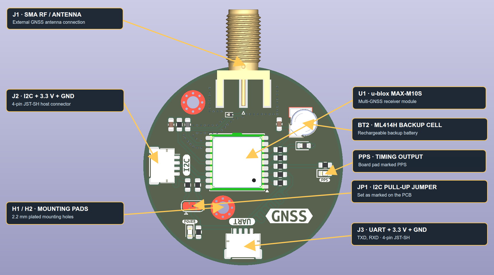
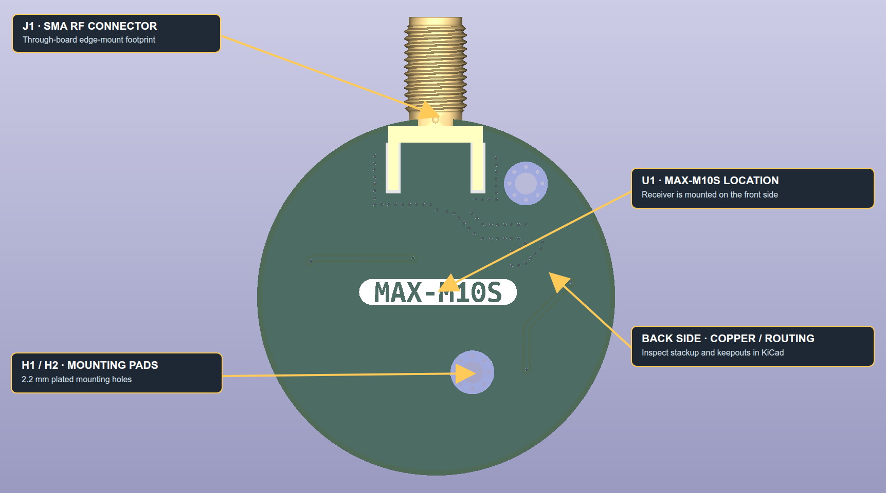

# MAX-M10S GNSS Receiver Board

A KiCad hardware design for a compact GNSS receiver based on the u-blox MAX-M10S module. The circular board brings out UART and I2C host interfaces, an SMA RF connector for an external GNSS antenna, a backup-cell footprint, and a PPS timing signal.

> **Design status:** this is a development design, not a production-released module. The current KiCad checks report open electrical/manufacturing items; see [Production readiness](#production-readiness) before building or ordering boards.

## Board views

### Front / component side

### Back side

The annotations identify board features and connectors. Connector pin numbering below follows the schematic/netlist; confirm pin 1 against the PCB silkscreen before wiring.

## Design overview

| Feature | Design detail |
| --- | --- |
| GNSS receiver | u-blox MAX-M10S (`U1`) |
| Board outline | Circular, approximately 36 mm diameter |
| PCB stackup | 4 copper layers; 1.6 mm nominal total thickness |
| RF connector | Edge-mount SMA (`J1`); antenna is external and not included |
| Host interfaces | 4-pin JST-SH I2C (`J2`) and UART (`J3`) |
| Backup supply | Seiko ML414H rechargeable backup cell (`BT2`) |
| Timing output | PPS signal brought to a board pad/test point |
| Design source | KiCad schematic and PCB in this repository |

The design's supply net is marked **+3.3 V**. The MAX-M10S device itself has a 1.65–3.6 V supply range; this does not make the whole board tolerant of arbitrary input voltages. Supply the board with a regulated 3.3 V on the connector's 3V3 pin. There is no USB interface.

## Connector pinouts

### `J2` — I2C and 3.3 V power

| Pin | Signal | Description |
| ---: | --- | --- |
| 1 | +3.3 V | Board supply |
| 2 | SDA | I2C data |
| 3 | SCL | I2C clock |
| 4 | GND | Ground |

### `J3` — UART and 3.3 V power

| Pin | Signal | Description |
| ---: | --- | --- |
| 1 | +3.3 V | Board supply |
| 2 | TXD | Receiver transmit; connect to host RX |
| 3 | RXD | Receiver input; connect to host TX |
| 4 | GND | Ground |

Both connectors expose the same board supply and ground. Do not connect multiple supplies at once unless the system power design explicitly permits it. Check the connector orientation and pin 1 on the physical PCB before applying power.

## RF antenna

`J1` is the board-edge SMA RF connection for an external GNSS antenna. The antenna is not integrated into the board. Use an antenna compatible with the MAX-M10S RF input and the intended installation; place it with a clear view of the sky and follow the antenna manufacturer's feed/bias requirements. Do not assume that antenna power is enabled or that any antenna will be supported without checking the schematic and RF path.

## Setup and use

1. Open `MAX-M10_GPS.kicad_pro` with KiCad 10 or a compatible newer release.
2. Review the schematic, PCB, custom SMA footprint library table, and the production-readiness items below.
3. Connect a regulated 3.3 V supply, ground, the host interface, and a suitable external GNSS antenna.
4. If using I2C, configure the solder jumper `JP1` as marked on the PCB to enable the I2C bus pull-up connection.
5. Connect a host to the UART or I2C interface and configure the receiver using the u-blox documentation.
6. Confirm GNSS reception, PPS behavior, power draw, RF performance, and recovery behavior on assembled hardware.

`BT2` is specified as a rechargeable ML414H backup cell. Use only a compatible rechargeable cell and verify the charging/backup circuit before assembly; do not substitute a primary, non-rechargeable coin cell.

## Repository contents

- `MAX-M10_GPS.kicad_pro` — KiCad project
- `MAX-M10_GPS.kicad_sch` — schematic
- `MAX-M10_GPS.kicad_pcb` — PCB layout
- `SMA_Amphenol_132289_EdgeMount_EDITED.pretty/` — project-local SMA footprint
- `fp-lib-table` — project-local footprint library registration
- `Front_MAX-M10_GPS.png`, `Back_MAX-M10_GPS.png` — original 3D board views
- `MAX-M10_GPS_front_annotated.png`, `MAX-M10_GPS_back_annotated.png` — labeled 3D board views
- `MAX-M10_GPS_front_annotated.svg`, `MAX-M10_GPS_back_annotated.svg` — editable annotation overlays

## Production readiness

The current design files were checked with KiCad 10.0.6. These are design-file checks only, not board fabrication, assembly, environmental, or RF qualification:

- **PCB DRC:** 1 violation — solder-mask apertures bridge different nets at the `BT2` backup-cell footprint, between the footprint polygon and pad 1 (`BACKUP`). Resolve this with the footprint/mask design and confirm the fabrication interpretation before release.
- **Unconnected PCB pads:** 0 reported.
- **Schematic ERC:** 3 errors for power-input pins without a recognized power-output driver, and 15 warnings. Review whether the power flags and repeated local/global labels are intentional, then clear or explicitly document each result.
- **BOM completeness:** resistor `R11` is marked `TBD`; finalize its value/part and review the complete BOM and assembly notes.

Before production, resolve or formally disposition the reported DRC/ERC findings; finalize and verify the BOM; review footprints, connector orientation, clearances, and fabrication outputs; and validate the assembled board's supply behavior, GNSS/RF performance, antenna configuration, UART/I2C/PPS operation, and environmental requirements. No production, accuracy, or certification claim is made by this repository.

## References

- [u-blox MAX-M10S data sheet](https://content.u-blox.com/sites/default/files/MAX-M10S_DataSheet_UBX-20035208.pdf)
- [u-blox documentation portal](https://www.u-blox.com/en/product/max-m10-series)

## GitHub repository description

> Circular u-blox MAX-M10S GNSS receiver breakout with SMA antenna input, UART, I2C, backup-cell support, and KiCad design files.

